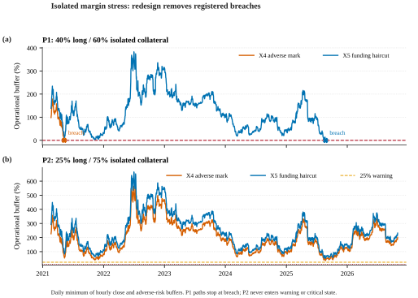
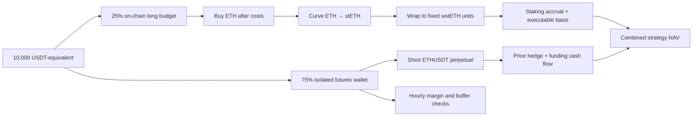
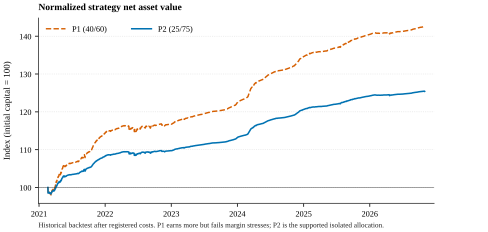
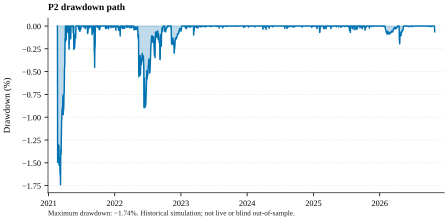

# Liquid-Staking Basis Research

<p align="left">
  
  
  
  
</p>

Reproducible research on delta-neutral ETH liquid-staking carry: long wstETH for staking
accrual and short ETHUSDT perpetual to hedge ETH price exposure. The project emphasizes
point-in-time data, preregistered acceptance gates, explicit execution costs, isolated
margin accounting, liquidation stress, and deterministic reruns.

> **Research only.** These are historical simulations, not investment advice, live
> results, or a claim of future profitability. No experiment in this repository
> authorizes real orders, wallet signing, or capital deployment.

## Research outcome

The highest-return version was rejected. A lower-exposure redesign passed the locked
standalone gates by pre-positioning more collateral in the isolated futures wallet.

| Experiment | Fixed allocation | Net return | CAGR | Sharpe | Max drawdown | Decision |
|---|---:|---:|---:|---:|---:|---|
| [001](experiments/results/001_delta_neutral_wsteth_carry.md) / P1 | 40% long / 60% collateral | 42.46% | 6.41% | 4.68 | -1.97% | Rejected: X4 and X5 margin breaches |
| [002](experiments/results/002_conservative_isolated_wsteth_carry.md) / P2 | 25% long / 75% collateral | 25.41% | 4.06% | 4.11 | -1.74% | Supported as an isolated candidate |

Experiment 002 is an in-sample redesign performed after observing Experiment 001. It is
not blind out-of-sample confirmation. It qualifies for later forward-validation
planning, not immediate paper or live trading.

<p align="center">
  
</p>

The central failure is **collateral drift**. When ETH appreciates, the on-chain wstETH
gains value while the isolated USDT futures wallet absorbs short losses. Combined NAV
may remain healthy even as the exchange wallet approaches liquidation. Monitoring alone
does not solve this; collateral must already be available where liquidation occurs.

## Strategy architecture



- Decisions use the last Ethereum block strictly before 00:00 UTC.
- CEX information at decision time ends with the prior completed hourly bar.
- Fills occur no earlier than the close of the 00:00 UTC bar.
- The perpetual hedge is resized only on the first calendar day of each month.
- No instant collateral rescue, cross-margin netting, or hidden external reserve is
  permitted.

## Historical paths

<p align="center">
  
</p>

<p align="center">
  
</p>

Experiment 002 survives every registered X1–X6 path. Its primary minimum operational
buffer is 64.80% of short notional above reserve; the X4 adverse-mark path remains at
36.75%. None of the registered P2 paths enters the 25% warning or 10% critical state.

## Experimental governance

This repository treats research process as part of the result:

1. Register the hypothesis, rules, costs, stresses, and thresholds on `main`.
2. Implement and run the experiment on an `exp/` branch.
3. Do not revise thresholds after observing performance.
4. Report rejected designs alongside supported designs.
5. Require point-in-time accounting, deterministic outputs, checksums, and repeat runs.
6. Merge only after the experiment has a supported conclusion.

The complete preregistrations are available for
[Experiment 001](experiments/preregistrations/001_delta_neutral_wsteth_carry.md) and
[Experiment 002](experiments/preregistrations/002_conservative_isolated_wsteth_carry.md).

## Data and execution model

The repository does not contain market datasets, API credentials, or RPC endpoints.
Local inputs include:

- Ethereum archive-state observations for Lido wstETH share rate;
- fixed-block Curve legacy-pool 10-token `get_dy` quotes;
- legacy and EIP-1559 gas-price state;
- Binance ETHUSDT spot, USD-M perpetual, mark-price hourly bars, and funding events;
- the independently frozen S4 COIN-M NAV for portfolio diagnostics.

Registered costs include spot and perpetual taker fees, adverse CEX slippage, additional
Curve slippage, ETH withdrawal allowance, gas, negative funding, and isolated-margin
reserve. Missing mark data use only the preregistered adverse proxy.

## Repository layout

```text
config/                         Frozen experiment and acquisition configuration
docs/                           Data audits, schemas, and generated visual assets
experiments/preregistrations/   Hypotheses and acceptance gates committed before runs
experiments/results/            Conclusive experiment reports
notebooks/                      Executable research walkthrough
scripts/                        Reusable figure-generation entry point
src/liquid_staking_basis/       Acquisition, audit, accounting, and experiment engines
tests/                          Synthetic unit and integration tests
```

## Reproduction

Python 3.13 is required. The full historical experiments also require locally acquired
inputs under a data root that is intentionally excluded from Git.

```bash
python -m pip install -e ".[dev,viz]"
export QUANT_RESEARCH_DATA_ROOT=/absolute/path/to/quant_research/data

ruff check src tests scripts
mypy src
pytest -q

lsb-experiment-001
lsb-experiment-002
lsb-figures --data-root "$QUANT_RESEARCH_DATA_ROOT"
```

For Ethereum acquisition, copy `.env.example` to `.env` and set a private archive RPC
endpoint. `.env`, datasets, Parquet files, credentials, and derived ledgers are ignored.

The executable narrative is
[notebooks/01_experiment_001_002_walkthrough.ipynb](notebooks/01_experiment_001_002_walkthrough.ipynb).
It regenerates the figures from local derived outputs and displays the locked metrics,
gates, and limitations.

## Verification

- 32 synthetic unit and integration tests;
- Ruff and mypy checks;
- unique funding-event accounting and sub-cent terminal reconciliation;
- contract-step, execution-delay, quote-size, and missing-data checks;
- byte-identical complete reruns for both experiments;
- GitHub Actions configuration that requires no private dataset.

## Limitations and next boundary

- The history was available when both designs were written; Experiment 002 is not blind
  OOS.
- Curve liquidity, smart-contract risk, exchange solvency, API latency, and live fills
  can differ materially from historical simulation.
- P2 is economically supported as an isolated strategy candidate but fails the locked
  S4 monthly-correlation and portfolio-CAGR diversification gates.
- Nearby capital splits, warning thresholds, and portfolio weights may not be searched
  on this sample and presented as confirmatory evidence.

The next legitimate research stage is a separately registered forward shadow-data and
paper-account protocol. No Raspberry Pi or trading deployment is included here.
